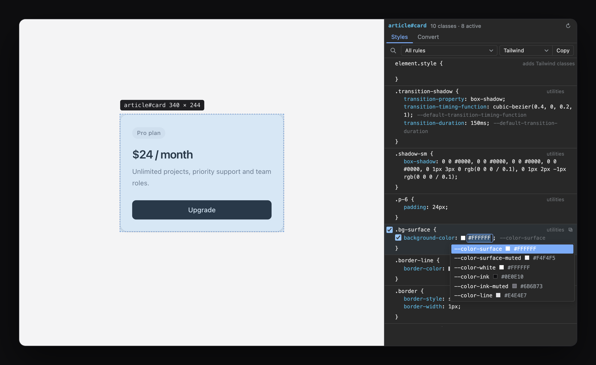
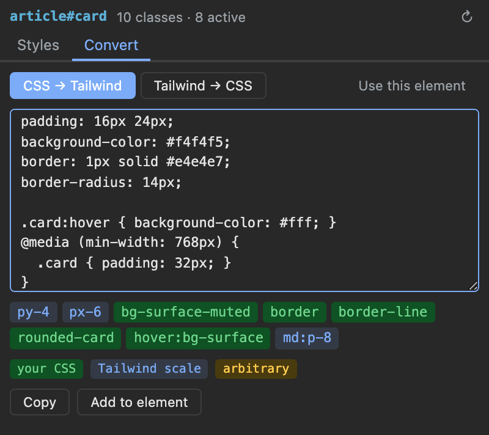

  <picture>
    <source media="(prefers-color-scheme: dark)" srcset="assets/logo-dark.svg">
    
  </picture>

  See the CSS behind every Tailwind class in DevTools, and edit it.

  
  
  
  

 

## Why

On a Tailwind element, the Styles pane shows `.p-6`, then `calc(var(--spacing) * 6)`, then a dozen `--tw-*` variables. Class Lens shows each class as the CSS it applies, with the values worked out: `padding: 24px`. You can edit it the way you edit the Styles pane, and the classes on the element update to match.

## Features

- **Every class as plain CSS**, in cascade order, with overridden values struck through.
- **Values resolved**: `24px`, not `calc(var(--spacing) * 6)`. Colours show a swatch and the token they come from.
- **Edit like the Styles pane**: change `16px` to `24px` and `p-4` becomes `p-6`.
- **Token suggestions**: editing a value lists your design tokens that fit that property, with their real values.
- **Hover, focus and breakpoint rules** are listed greyed out, so you can edit them without forcing the state.
- **Inline styles, your own CSS, and rules added in DevTools** are all listed and editable.
- **Copy** as Tailwind, `className`, or CSS: the whole element or a single rule.
- **Convert** CSS to Tailwind and back, using your project's own classes first.
- **No permissions, no network requests, no tracking.**

## Install

1. Download `class-lens.zip` from the [latest release](https://github.com/ianarchivo/class-lens/releases/latest) and unzip it, or clone this repo.
2. Open `chrome://extensions` (Opera: `opera://extensions`, Edge: `edge://extensions`).
3. Turn on **Developer mode**, click **Load unpacked**, and pick the folder.
4. Close DevTools and open it again. DevTools only loads extensions when it opens.
5. Open the **⊙ Class Lens** tab. It's in the Elements sidebar next to Styles and Computed, and in the top row next to Console. It may be hidden behind `»`. Drag it to the front and DevTools remembers where you put it.

Tested in Chrome and Opera GX. It should work in any Chromium browser on version 120 or later.

## Styles tab

Select an element in the Elements panel and Class Lens lists its rules: `element.style`, then one rule per class, then your own CSS. Each line shows the value as the browser computes it. Hover it to see what was written.

| You edit | What changes |
| --- | --- |
| A Tailwind class | The class is swapped for the one with the new value. |
| Your own CSS rule, or a rule added with `+` in DevTools | The rule is edited in place. |
| `element.style` | The inline style on the element. **→ class** moves it into a Tailwind class. |

- **Add a property**: click inside `element.style` (or below the last line of any rule), type a property, press `:` or Tab, type a value, press Enter. Class Lens shows the class it will add as you type (`→ mt-2`). You can also type a class name directly.
- **Rename or remove a class**: click its selector. Clear it to remove the class.
- **Turn things off**: the checkbox next to a selector takes the class off the element. The one next to a property turns that property off in its rule. Turned-off lines stay in the list.
- **Classes that aren't in your build yet** are previewed live. Class Lens writes the CSS they would produce, based on similar classes on the page.
- **Reset** puts back the classes the element had before you edited it.
- **Filter** with the search icon or `/`. `Esc` clears it.

## Convert tab

- **CSS → Tailwind**: paste declarations, rules or `@media` blocks. `:hover` becomes `hover:`, `@media (min-width: 768px)` becomes `md:`. Green classes come from your project, blue from Tailwind's default scale, yellow are arbitrary values.
- **Tailwind → CSS**: paste classes and get the CSS they produce, with values worked out.
- **Use this element** fills the box from the selected element. **Add to element** applies the result.

## How it works

Class Lens reads the page's stylesheets through DevTools, parses them in the panel, and matches each class against every selector, including nested CSS, `@layer`, `@media`, `@supports` and `@container`. It works out values on a hidden probe element and ranks rules the way the cascade does: importance, layer, specificity, then order. Edits go through the CSSOM, or through DevTools' resource API for rules you added with `+`.

Nothing leaves your browser.

## Limits

- Container queries are shown but not evaluated.
- Values in `%` or viewport units are shown as written, because they depend on layout.
- Generating CSS for classes outside your build covers the common patterns: spacing, tokens, arbitrary values and keyword utilities. Anything else shows "unknown class".
- Previews are unlayered CSS, so they win over utilities while you try things. Your real build may order them differently.
- Tailwind's base layer (the reset) isn't listed.
- Browser pages (`chrome://`, the new tab page) can't be inspected by extensions.

## Development

There's no build step. Edit the files, click reload on the extension card, then close and reopen DevTools.

| File | What it does |
| --- | --- |
| `core.js` | Parses CSS, matches classes, works out the cascade. |
| `tailwind.js` | Converts between CSS and Tailwind. |
| `panel.js` | The panel UI and the code that runs in the inspected page. |
| `panel.css` | Panel styles, light and dark. |
| `devtools.js` | Registers the sidebar pane and the panel. |

## License

[MIT](LICENSE)
